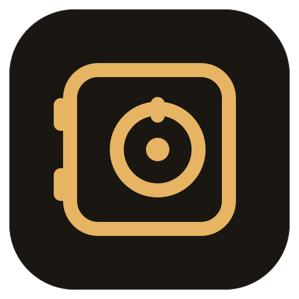
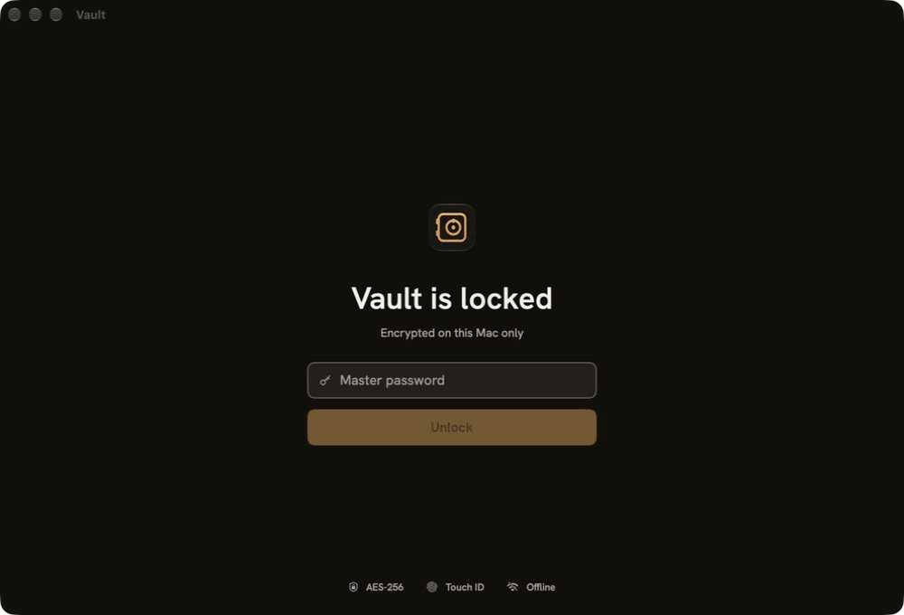
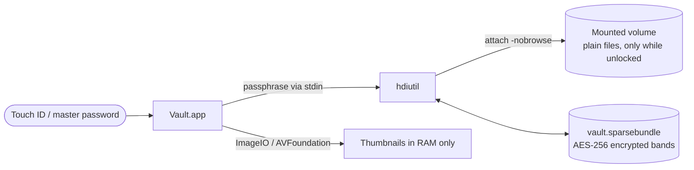
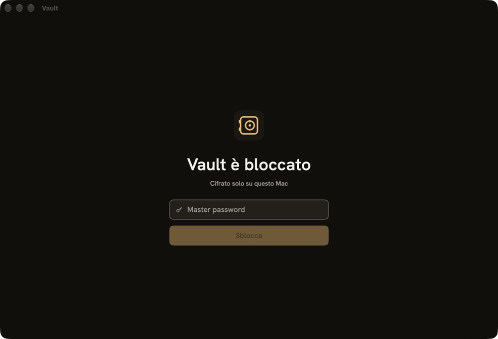
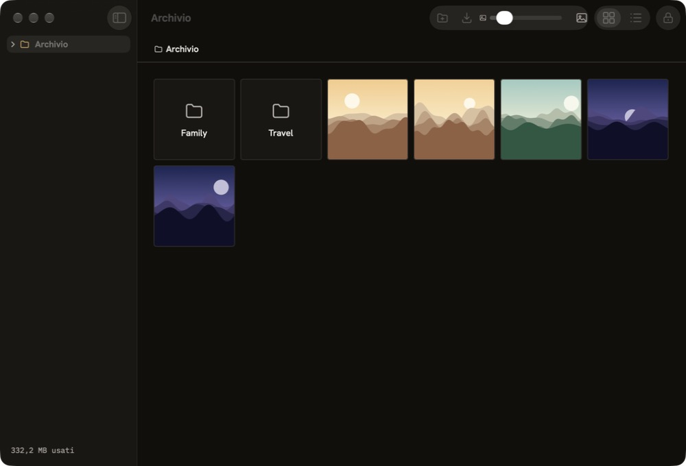
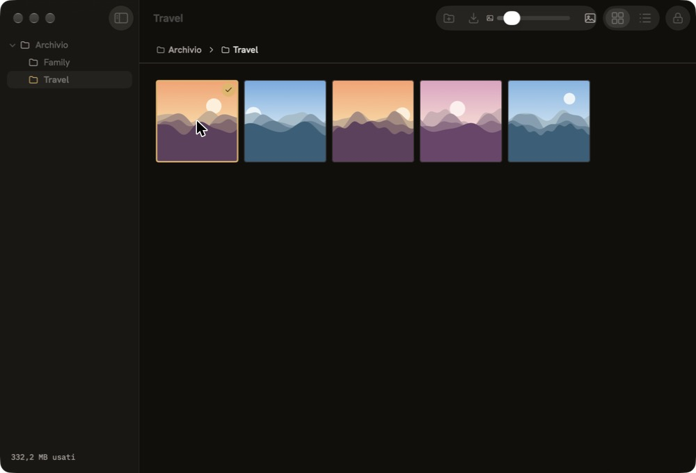
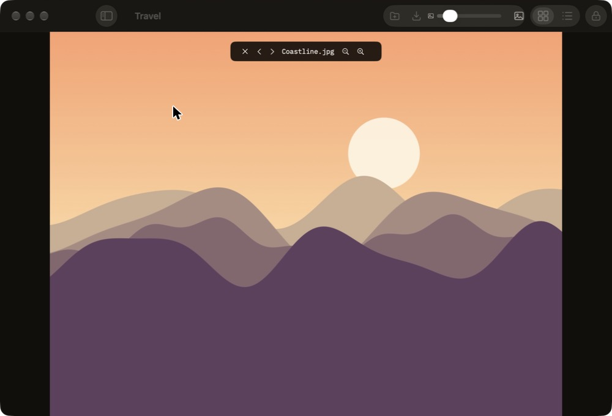

<p align="center"></p>

<h1 align="center">Vault</h1>

<p align="center">
A private, offline photo &amp; video vault for macOS.<br>
Encrypted on disk with AES-256, unlocked with Touch ID, gone from the filesystem the moment it locks.
</p>

<p align="center">


</p>

<p align="center"></p>

## Why

The Photos app keeps everything one click away from anyone who sits at your Mac,
and "hidden" albums are not encrypted. Vault is a small native app for the
pictures and videos you actually want locked: they live inside an encrypted disk
image that is only mounted while the app is unlocked.

## How it works



1. **Unlock.** Touch ID or the master password. The password goes to `hdiutil`
   through **stdin** (`-stdinpass`), never as an argument, so it never shows up in
   `ps` or in logs.
2. **Mount.** The encrypted sparsebundle is attached with `-nobrowse -noautoopen`
   to a hidden mount point inside Application Support: it never appears in Finder,
   on the Desktop or in Spotlight (`.metadata_never_index`).
3. **Browse.** Thumbnails are decoded with ImageIO / AVFoundation and cached in an
   `NSCache` — memory only. No QuickLook thumbnail cache, no temp files outside the
   encrypted volume.
4. **Lock.** Every lock trigger (⌘L, idle timeout, sleep, screen lock, screensaver,
   fast user switching, quit) goes through one `lock()` function that drops the
   thumbnails and **unmounts the volume**. After that the files exist only as
   ciphertext.
5. **Compact.** On quit the image is compacted so deleted files actually give their
   space back.

### Touch ID without the Keychain

The master password is sealed with **HPKE** (CryptoKit) to a **Secure Enclave**
P-256 key created with `biometryCurrentSet`. The private key never leaves the
chip and only works after a successful fingerprint; if the enrolled fingerprints
change, the key is invalidated and the password is required again. This avoids
the Keychain entirely (no system prompts, works without a paid signing team).

### Other hardening

- The window is excluded from screenshots and screen recording (`sharingType = .none`).
- No window state restoration, no `NSDocument`. Files open in the built-in viewer,
  never in Preview or QuickTime, so they don't land in Recents.
- On lock, anything copied from the vault is cleared from the clipboard.
- Zero network code: no `URLSession`, no analytics, no update checks.

## Where your data lives

Everything stays on your Mac, in one folder:

```
~/Library/Application Support/Vault/
├── vault.sparsebundle/   encrypted disk image (AES-256, HFS+, grows up to 200 GB)
├── touchid               password sealed to the Secure Enclave key (optional)
└── .mnt/                 mount point — has content only while Vault is unlocked
```

Deleting that folder deletes the vault. Back it up like any other file: the
sparsebundle is safe to copy to an external drive or a cloud folder, since it's
ciphertext. Without the master password it cannot be opened — there is no recovery.

## Tech stack

| | |
|---|---|
| Language / UI | Swift 6, SwiftUI with a little AppKit |
| Encryption | `hdiutil` encrypted sparsebundle (AES-256) — no custom crypto |
| Biometrics | LocalAuthentication, Secure Enclave, CryptoKit HPKE |
| Media | ImageIO, AVFoundation, AVKit |
| Build | plain `swiftc` + `codesign` (ad-hoc, Hardened Runtime) — no Xcode project |
| Tests | assert-based test executable (`Tests/main.swift`) |
| Dependencies | none — Apple frameworks only |

The whole app is ~1,300 lines of Swift.

## Features

- Grid and list views with thumbnails, folders, clickable breadcrumb
- Built-in viewer for photos and videos (Space), with zoom
- Import, export, rename, move, delete
- Drag and drop: inside the app it moves, onto Finder or another app it exports
- Auto-lock after inactivity (configurable)

| Shortcut | Action |
|---|---|
| ⌘O | Import |
| ⇧⌘E | Export |
| ⇧⌘N | New folder |
| ⌘↑ | Parent folder |
| ⌘⌫ | Delete |
| ⌘= / ⌘− | Zoom in viewer |
| ⌘L | Lock |

The interface is in Italian.

## Screenshots

| Locked | Browsing |
|---|---|
|  |  |
| **Folders** | **Viewer** |
|  |  |

## Build

Requires macOS 26 on Apple Silicon and the Command Line Tools (`swiftc`). Xcode is not needed.

```bash
scripts/build-app.sh            # → build/Vault.app
scripts/build-app.sh --install  # copy to /Applications
scripts/test.sh                 # tests (create and mount a real throwaway vault)
scripts/leakcheck.sh            # anti-leak checklist, see docs/checklist.md
```

If a newer Command Line Tools release fails with *"plugin for module
'SwiftUIMacros' not found"*, build against the macOS 26 SDK:
`SDKROOT=/Library/Developer/CommandLineTools/SDKs/MacOSX26.5.sdk scripts/build-app.sh`.

Debug builds only (`--debug`): `VAULT_DIR=<folder>` uses a throwaway vault and
`VAULT_TEST_PASSWORD=<pw>` unlocks it automatically — that's how the screenshots
above were made (the photos are generated placeholders).

## Project layout

```
Sources/Vault/
  VaultApp.swift     app entry, AppModel, the single lock() and its triggers
  Vault.swift        hdiutil wrapper: create, mount, compact, unmount
  Unlock.swift       Touch ID: Secure Enclave key + HPKE-sealed password
  LockView.swift     lock / setup screen
  BrowserView.swift  grid, list, sidebar, drag and drop
  Viewer.swift       photo and video viewer
  Thumbnails.swift   in-memory thumbnail cache
  Theme.swift        design tokens
Tests/main.swift     tests
docs/checklist.md    anti-leak checklist
```
